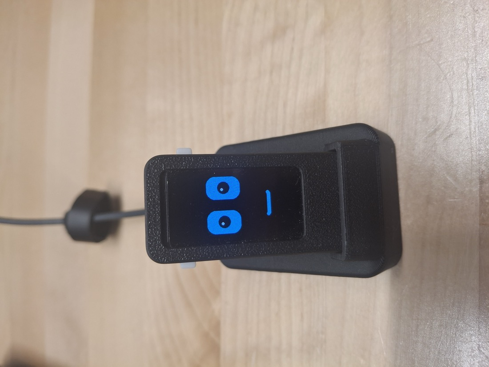

# RoboFace for the Waveshare ESP32-C6-LCD-1.47



A cartoon face for the **Waveshare ESP32-C6-LCD-1.47** (non-touch) 1.47" display board.

- Two eyes with pupils that **blink** (sometimes twice) and **glance around**
- Every so often it **smiles**, and the eyes squint happily
- The onboard **RGB LED cycles slowly through the rainbow**
- Gamma-corrected **backlight dimming**, so 50 % looks like half brightness

Written for a battery enclosure with a magnetic charging dock (published separately on MakerWorld), but it runs on a bare board too.

<br clear="right">

## Hardware
- Waveshare ESP32-C6-LCD-1.47 (ESP32-C6, 172 × 320 ST7789 display, WS2812 RGB LED on GPIO 8)
- No other parts needed

## Building and flashing (Arduino IDE)
1. **Board package:** in Boards Manager, install **esp32 by Espressif Systems**, version **3.x**. That release line supports the ESP32-C6.
2. **Libraries:** in Library Manager, install:
    - **Adafruit GFX Library**
    - **Adafruit ST7735 and ST7789 Library**
3. Open `RoboFace/RoboFace.ino`.
4. **Tools menu:**
    - Board: **ESP32C6 Dev Module**
    - USB CDC On Boot: **Enabled**. The sketch prints a backlight status line over USB serial every 5 s.
    - Port: the board's USB serial port
5. Click **Upload**.

### Arduino CLI
```bash
arduino-cli compile --fqbn esp32:esp32:esp32c6:CDCOnBoot=cdc RoboFace
arduino-cli upload  --fqbn esp32:esp32:esp32c6:CDCOnBoot=cdc -p <your-port> RoboFace
```

## Settings
These are at the top of `RoboFace.ino`:

| Setting | Default | What it does |
|---|---|---|
| `ROTATION` | `0` | Screen orientation. Set `2` to flip the face upside down, e.g. if your case stands the board USB-end up |
| `BACKLIGHT_PCT` | `50` | Screen brightness, 0–100, as you *perceive* it (gamma-corrected) |
| `LED_BRIGHTNESS` | `60` | RGB LED brightness, 0–255 |
| `LED_CYCLE_MS` | `6000` | Time for one full trip round the colour wheel |
| `PUPIL_R` | `14` | Pupil radius in pixels |

Eye, pupil and highlight colours are set in `setup()`.

## Troubleshooting
- **No serial port, or the upload can't connect:**
    - Try another USB cable. Some are charge-only, or marginal.
    - Close any other serial monitor that might be holding the port.
    - If it still won't connect, hold **BOOT**, plug in USB, then release BOOT to force the bootloader.
- **Colours look inverted** (white background): your panel may need the opposite inversion setting. Add `tft.invertDisplay(false)` or `tft.invertDisplay(true)` after `tft.init(...)` in `setup()`.

## Pin map (Waveshare ESP32-C6-LCD-1.47)
| Function | GPIO |
|---|---|
| LCD MOSI / SCLK | 6 / 7 |
| LCD CS / DC / RST | 14 / 15 / 21 |
| LCD backlight (PWM) | 22 |
| RGB LED (WS2812) | 8 |

## License
MIT. See [LICENSE](LICENSE).
